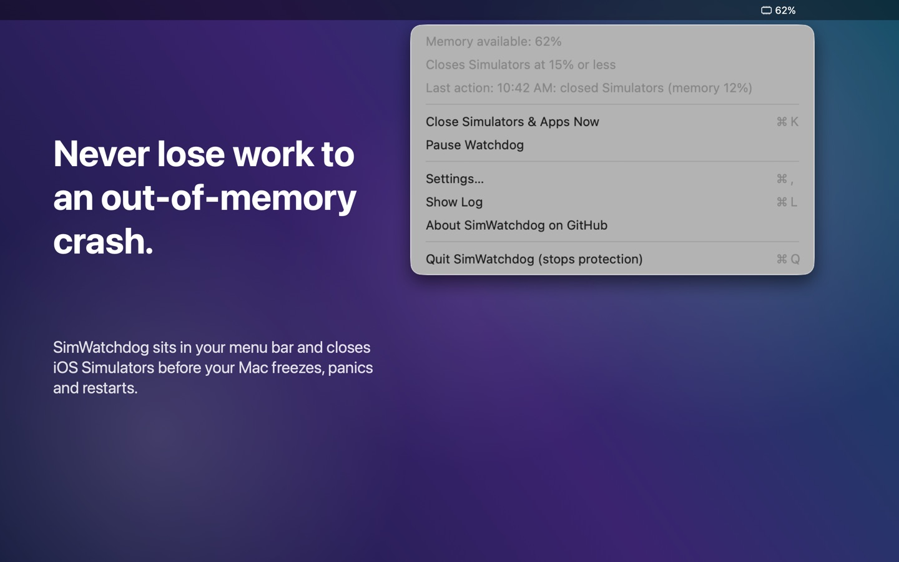
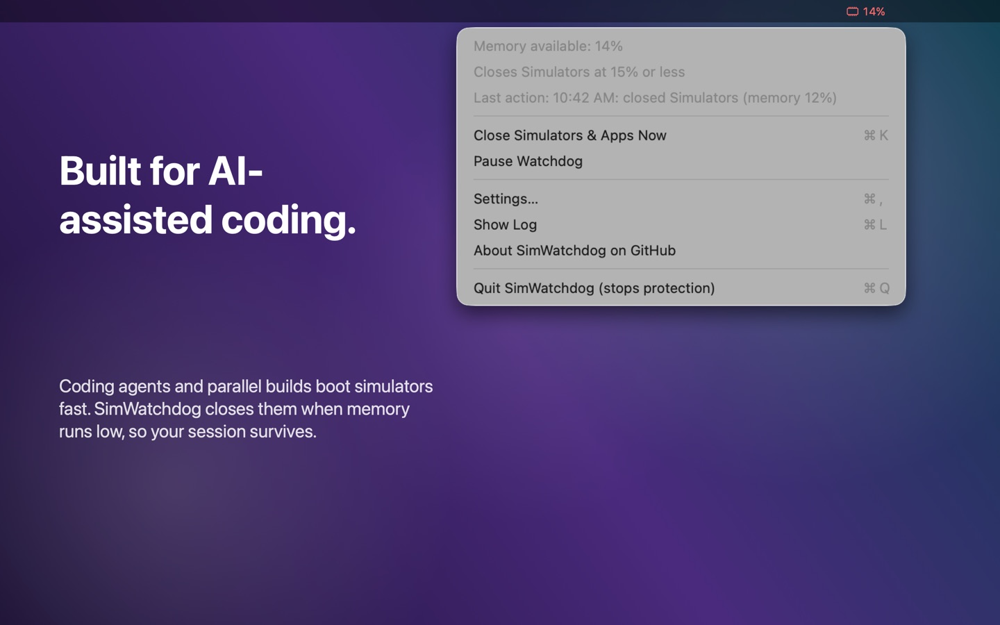
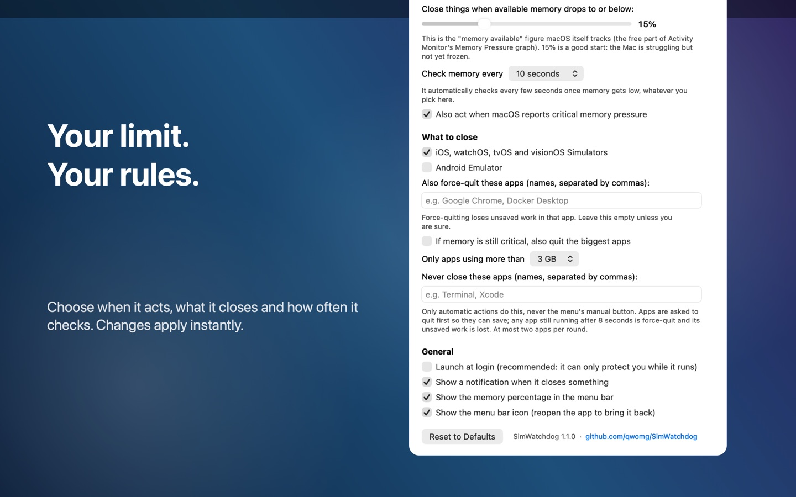

# SimWatchdog: stop your Mac from crashing when it runs out of memory

**A tiny free menu bar app that watches your Mac's memory and force-closes iOS Simulators (and optionally the Android Emulator or any app you choose) *before* macOS freezes, panics and restarts.**

If your Mac keeps showing **"Your computer was restarted because of a problem"** while you run Xcode, several iOS Simulators, UI tests, an Android emulator, or **AI coding agents like Claude Code, Codex and Cursor**, this is for you.

<p align="center">
  
</p>

- Lives in the menu bar and shows your free memory (turns red as you get close)
- Closes simulators automatically when available memory drops below a level you choose, and (opt-in) asks the biggest apps to quit if memory is still critical
- Writes a **"TOP apps" line to its log every time it triggers**, so you can see what was really eating your memory
- About 55 MB of RAM and 0% CPU when idle: it reads one number from the kernel every few seconds
- Universal binary (Apple Silicon and Intel), macOS 13 or later, no dependencies, no network access, no telemetry
- Free and open source (MIT)

## Install

**Homebrew:**

```bash
brew install --cask qwomg/tap/simwatchdog
```

**One line** (downloads the latest release, checks its checksum, installs to `/Applications`, opens it):

```bash
curl -fsSL https://raw.githubusercontent.com/qwomg/SimWatchdog/main/install.sh | bash
```

**Or manually:** download `SimWatchdog.zip` from the [latest release](https://github.com/qwomg/SimWatchdog/releases/latest), unzip, drag **SimWatchdog.app** to **Applications**, and open it.

> **macOS may warn you the first time** ("Apple could not verify..."). The free build is signed ad-hoc but not notarized by Apple. The Homebrew and one-line installs remove that warning for you. If you downloaded the zip yourself: **System Settings > Privacy & Security > scroll down > Open Anyway**, or run
> `xattr -dr com.apple.quarantine /Applications/SimWatchdog.app`. You can read every line of the source, or [build it yourself](#build-from-source) in about a minute.

On first launch it asks whether to start at login. Say yes: it can only protect you while it is running.

## Built for vibe coding and AI-assisted development

<p align="center">
  
</p>

Claude Code, OpenAI Codex, Cursor, Windsurf, GitHub Copilot's agent mode, Cline, Aider, Gemini CLI and friends are great at building and *verifying* iOS and macOS apps, and the way they verify is by booting simulators. That is where Macs get into trouble, fast:

- An agent boots a simulator to check its work, then moves on. Nobody shuts it down.
- You run **several agents or git worktrees in parallel**, each with its own simulator, build and test run.
- Agents loop on `xcodebuild test`, which spawns **parallel clone simulators**. Every clone is gigabytes.
- Simulator MCP servers and "run the app and take a screenshot" tools make booting a device a one-line action, so a dozen devices pile up without anyone noticing.
- On top of that: Xcode, SwiftUI previews, the agent's own tooling, your browser, Docker.

Humans notice memory pressure and close things. **Agents don't.** Eventually macOS compresses everything, starts swapping, freezes, and sometimes **kernel-panics and restarts, taking your unsaved work and the agent's whole session with it.**

SimWatchdog is the safety net for that workflow. You don't integrate it with anything, and no agent needs to know it exists: start it once and it sits in the menu bar. When available memory runs low it closes the simulators, so your agent hits "device not booted" (which it can retry) instead of your Mac hitting a restart screen.

Tips for AI-heavy workflows:

- Keep the default 15% trigger, or raise it to 20-25% if you run many agents at once.
- Tick **Android Emulator** if your agents also build Android, and add heavyweight apps (for example `Docker Desktop`) to the force-quit list if you want a bigger safety net.
- Put `xcrun simctl shutdown all` at the end of your agent's test scripts too. SimWatchdog is the backstop, not an excuse to leave devices booted.
- Tell the agent in your `CLAUDE.md` / `AGENTS.md` / Cursor rules: *"Shut down simulators when you are done: `xcrun simctl shutdown all`."*

## Settings

<p align="center">
  
</p>

Click the menu bar icon > **Settings...** (or just open the app again).

| Setting | Default | What it does |
| --- | --- | --- |
| Act when available memory is at or below | 15% | The trigger level (5-40%). |
| Check memory every | 10 seconds | 5 s, 10 s, 30 s, 1 min or 5 min. It speeds up by itself when memory is low. |
| Also act on critical memory pressure | on | Triggers when macOS itself says pressure is critical, even above the threshold. |
| iOS / watchOS / tvOS / visionOS Simulators | on | Shut down and kill all simulator processes. |
| Android Emulator | off | Also kill running Android emulators. |
| If memory is still critical, also quit the biggest apps | off | Opt-in. After simulators and listed apps are closed, if memory is still low it asks the largest apps (Chrome and Electron apps count all their helper processes) to quit, and force-quits any still running after 8 seconds. At most 2 apps per round. |
| Only apps using more than | 3 GB | Size an app must reach to be a candidate (1-8 GB). |
| Never close these apps | empty | Names (comma-separated) that are never closed automatically, e.g. `Terminal, Xcode`. Finder, the Dock and SimWatchdog itself are always protected. |
| Force-quit these apps | empty | Names (comma-separated) of other apps to force-quit, e.g. `Google Chrome, Docker Desktop`. Unsaved work in them is lost, so use with care. |
| Launch at login | asks on first run | Starts SimWatchdog when you log in. |
| Notification, % in menu bar, show icon | on | Cosmetic. If you hide the icon, open the app again to bring it back. |

Menu bar menu: **Close Simulators & Apps Now** (one-click panic button, ⌘K), **Pause Watchdog**, **Show Log**, **Quit**. The log lives at `~/Library/Logs/SimWatchdog.log`.

## Why this exists

iOS Simulators are memory hogs. Each booted device (an iPhone, an iPad, a paired Apple Watch, and a few OS versions side by side) takes gigabytes, and Xcode, SwiftUI previews, parallel UI tests and AI coding tools running simulators add up. When the Mac runs out of memory, macOS first compresses memory, then swaps to disk, then everything crawls, and sometimes the **kernel panics and the Mac restarts**.

macOS has no setting for "when memory is almost gone, close the simulators". SimWatchdog is that setting.

## Is this your problem?

You probably want this if any of these sound familiar:

- My **Mac restarts by itself** while Xcode / the iOS Simulator / an AI coding agent is running
- "**Your computer was restarted because of a problem**" / "macOS kernel panic" / "Mac keeps crashing" when building or running tests
- My **Mac freezes or gets extremely slow** with several simulators open, then recovers (or doesn't)
- **Xcode simulator memory usage** is huge; `CoreSimulator`, `launchd_sim` or `Simulator` use many GB
- **Out of memory** warnings, "Your system has run out of application memory", memory pressure stays **red** in Activity Monitor
- I need a way to **automatically kill the simulator when memory is low**, or **auto-quit apps when RAM is full** on a Mac
- My **Claude Code / Codex / Cursor session** crashed my Mac while it was testing an iOS app
- My Android emulator and Xcode together make the Mac unusable

### Check your panic log

macOS saves kernel panic reports in `/Library/Logs/DiagnosticReports/` (or open **Console > Crash Reports**, look for files ending in `.panic` or a name starting with `Kernel`). Open the newest one and search for this line:

```
Compressor Info: 100% of compressed pages limit (BAD) and 63% of segments limit (OK) with 17 swapfiles ...
```

If the compressor is at or near **100% with "(BAD)"** and there are many swap files, the Mac had run out of memory when it died, and keeping simulators from eating it all is exactly what SimWatchdog does.

> **Honest limits.** SimWatchdog prevents *memory exhaustion*. It cannot fix panics caused by hardware, a bad driver or a macOS bug (for example `AppleOLYHAL`, `AppleMultiFunctionManager`, `IOPCIFamily`, `AppleARMPlatform` or `Timeout period of 20000 ms expired waiting for event message` in the backtrace). In those the exhausted memory is often a *contributing* factor rather than the root cause, so reducing memory pressure helps but is not a guarantee. If your Mac still panics with plenty of free memory, report it to Apple with Feedback Assistant.

## How it works

1. Every few seconds it reads the kernel's `kern.memorystatus_level` (the percentage of memory macOS considers available, the same figure behind Activity Monitor's *Memory Pressure* graph) and `kern.memorystatus_vm_pressure_level`.
2. If available memory is at or below your threshold (default **15%**), or macOS reports *critical* pressure, it checks again 3 seconds later so a momentary spike doesn't trigger it.
3. If it is still low, it runs `xcrun simctl shutdown all`, waits at most 4 seconds, then force-kills whatever simulator processes are left, and shows a notification.
4. If **"also quit the biggest apps"** is on and memory is still low 5 seconds later, it asks the largest non-protected apps over your size limit to quit (so they can save), force-quits any that are still running after 8 seconds, and logs which ones.
5. It then waits 45 seconds before it can act again. As memory gets close to the limit it automatically checks more often, whatever interval you chose.

Everything else (Xcode, your editor, browsers) is left alone unless you list it in the settings or turn on the biggest-apps option.

### Why it also watches the pressure level, not just "memory available"

macOS's "memory available" percentage can look healthy while the Mac is already in trouble. On a 36 GB Mac, SimWatchdog's log recorded **42% available at the same moment macOS reported *critical* pressure** and put up "Your system has run out of application memory". That is why SimWatchdog triggers on either signal, and why it logs the pressure level.

### How it was tested

- **Kill path:** with real simulators booted and a simulated low reading (`--fake-level 3`), the app shut them all down within seconds; with `--dry-run` it changed nothing.
- **Real memory readings:** with the threshold raised to sit just above the Mac's live reading (no faked number), the app read the real kernel values (39% available, pressure level "warn"), triggered, and logged what it would close.
- **A real failure that taught us something (11 Oct 2026):** overnight, with no simulators running, three apps (ChatGPT 8.4 GB, Claude 9.5 GB, Chrome 9.8 GB) filled a 36 GB Mac and it froze. SimWatchdog 1.0 noticed the critical pressure but only knew how to close simulators, so it could not help. Version 1.1 adds the biggest-apps step and the TOP apps log line. That scenario was reproduced with a harmless stand-in app (TextEdit): under a simulated low-memory reading it was asked to quit and quit.
- **Idle cost:** 0.0% CPU and about 55 MB RSS, sampled over time.
- **Not tested:** driving a Mac all the way to the edge of out-of-memory on purpose (that is the crash we are trying to avoid), Intel hardware, and macOS 13-15. Reports welcome.

## Other ways to stop a Mac from running out of memory with Xcode

Even if you don't use SimWatchdog, these help:

```bash
xcrun simctl shutdown all              # shut down every booted simulator
xcrun simctl delete unavailable        # remove simulators for runtimes you no longer have
xcrun simctl list devices booted       # see what is booted right now
```

- Boot **fewer devices at once**. Every extra paired watch and iPad is gigabytes.
- Limit parallel testing: `xcodebuild test -parallel-testing-enabled NO` or `-maximum-parallel-testing-workers 2`.
- Close SwiftUI previews and extra Xcode windows you aren't using.
- Watch **Activity Monitor > Memory > Memory Pressure**. Green is fine, yellow means trouble is coming, red means you are about to freeze.
- Leave a few GB of free disk space: macOS swaps to disk when RAM is full, and a nearly full disk makes it much worse.

## Build from source

You need Xcode or the Xcode command line tools (built and tested with Xcode 27).

```bash
git clone https://github.com/qwomg/SimWatchdog.git
cd SimWatchdog
./build.sh                      # creates build/SimWatchdog.app (universal) and build/SimWatchdog.zip
open build/SimWatchdog.app
```

The whole app is five small Swift files in `Sources/`. There are no third-party dependencies. Maintainers: see [docs/RELEASING.md](docs/RELEASING.md) for signing and notarizing.

### Testing without running out of memory

Launch flags exist for testing (run the binary inside the app bundle):

```bash
SimWatchdog.app/Contents/MacOS/SimWatchdog --fake-level 3 --dry-run   # pretend memory is at 3%, log what it would close
SimWatchdog.app/Contents/MacOS/SimWatchdog --fake-level 3              # same, but really close simulators
SimWatchdog.app/Contents/MacOS/SimWatchdog -threshold 40 -interval 2   # override a setting for this run only
SimWatchdog.app/Contents/MacOS/SimWatchdog --snapshot settings.png     # render the settings window to a PNG
SimWatchdog.app/Contents/MacOS/SimWatchdog --snapshot-menu menu.png    # open the menu and capture it
```

## Uninstall

Quit SimWatchdog from its menu, delete `SimWatchdog.app` (or `brew uninstall --cask simwatchdog`), and (optional) remove its settings and log:

```bash
defaults delete io.github.qwomg.SimWatchdog
rm -f ~/Library/Logs/SimWatchdog.log
```

If you enabled *Launch at login*, turn it off first in the settings, or remove it in **System Settings > General > Login Items**.

## FAQ

**My Mac still froze. Why?** Open the log (menu bar icon > Show Log) and find the last `TOP apps:` line. If the biggest users are not simulators, turn on *If memory is still critical, also quit the biggest apps* in Settings. If one app (browsers and Electron apps are the usual suspects) grows without stopping, that app has a memory leak: SimWatchdog can keep your Mac alive, but only that app's developer can fix the leak.

**Will it close my simulators while I'm using them?** Only when your Mac is nearly out of memory (15% available by default), which is when the alternative is a freeze or a crash. Lower the threshold, or pause it from the menu, if you disagree.

**Does it kill Xcode?** No. By default it only touches simulator processes.

**Does it work with Claude Code, Codex, Cursor and other AI coding tools?** Yes, with no setup: it watches the whole Mac, so it doesn't matter which tool booted the simulator. See [Built for vibe coding](#built-for-vibe-coding-and-ai-assisted-development).

**Is it on the Mac App Store?** No, and it can't be. App Store apps must run in Apple's App Sandbox, and a sandboxed app cannot see or close other processes. We built a sandboxed version to check: with simulators running it found "nothing to close". The app has to be distributed outside the App Store.

**Does it work on Intel Macs and older macOS?** It is built as a universal binary for macOS 13 and later. It has been tested on Apple Silicon running macOS 26 (Tahoe); Intel and macOS 13-15 are expected to work but untested, so please report what you find.

**Does it send any data anywhere?** No. It makes no network connections and has no analytics. It reads two kernel values and runs `xcrun`, `pgrep` and `pkill`.

**Why isn't it notarized?** Notarization needs a paid Apple Developer ID certificate. The free build is ad-hoc signed (the Homebrew and one-line installs handle the macOS warning for you); a notarized build may be offered later.

## Contributing

Issues and pull requests are welcome, especially: reports from Intel and older macOS, more emulator/app presets, and a notarized build. If SimWatchdog saved you from a crash, a star helps other people with the same problem find it.

## License

[MIT](LICENSE)

<sub>Keywords: macOS kernel panic, Mac restarts unexpectedly, "your computer was restarted because of a problem", Xcode iOS Simulator memory, CoreSimulator high memory, out of memory Mac, memory pressure red, kill simulator when low memory, auto quit apps low RAM macOS, Apple Silicon M1 M2 M3 M4 memory crash, Android emulator Mac freeze, compressor limit BAD panic, menu bar memory watchdog, vibe coding Mac crash, Claude Code iOS simulator, Codex iOS simulator memory, Cursor Xcode simulator, AI coding agent simulators memory, parallel agents git worktrees Xcode.</sub>
