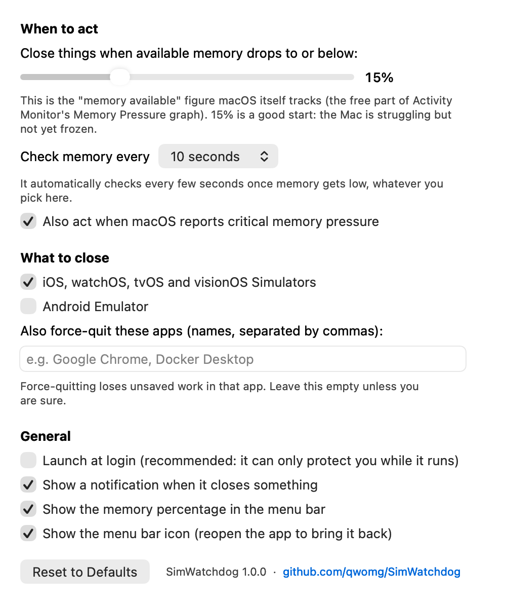

# SimWatchdog: stop your Mac from crashing when it runs out of memory

**A tiny free menu bar app that watches your Mac's memory and force-closes iOS Simulators (and optionally the Android Emulator or any app you choose) *before* macOS freezes, panics and restarts.**

If your Mac keeps showing **"Your computer was restarted because of a problem"** while you run Xcode, several iOS Simulators, UI tests or an Android emulator, this is for you.

<p align="center">
  
</p>

- Lives in the menu bar and shows your free memory (turns red when you're getting close)
- Closes simulators automatically when available memory drops below a level you choose
- Uses roughly 50-80 MB of RAM (a normal menu bar app) and almost no CPU: it reads one number from the kernel every few seconds
- Universal binary (Apple Silicon and Intel), macOS 13 or later, no dependencies, no network access, no telemetry
- Free and open source (MIT)

## Install

**One line** (downloads the latest release, checks its checksum, installs to `/Applications`, opens it):

```bash
curl -fsSL https://raw.githubusercontent.com/qwomg/SimWatchdog/main/install.sh | bash
```

**Or manually:** download `SimWatchdog.zip` from the [latest release](https://github.com/qwomg/SimWatchdog/releases/latest), unzip, drag **SimWatchdog.app** to **Applications**, and open it.

> **macOS will warn you the first time** ("Apple could not verify..."). SimWatchdog is signed ad-hoc but not notarized by Apple yet. To open it anyway: **System Settings > Privacy & Security > scroll down > Open Anyway**, or run
> `xattr -dr com.apple.quarantine /Applications/SimWatchdog.app`. The one-line installer does this for you. You can read every line of the source below, or [build it yourself](#build-from-source) in about a minute.

On first launch it asks whether to start at login. Say yes: it can only protect you while it is running.

## Why this exists

iOS Simulators are memory hogs. Each booted device (an iPhone, an iPad, a paired Apple Watch, and a few OS versions side by side) takes gigabytes, and Xcode, SwiftUI previews, parallel UI tests and AI coding tools running simulators add up. When the Mac runs out of memory, macOS first compresses memory, then swaps to disk, then everything crawls, and sometimes the **kernel panics and the Mac restarts**, taking your unsaved work with it.

macOS has no setting for "when memory is almost gone, close the simulators". SimWatchdog is that setting.

## Is this your problem?

You probably want this if any of these sound familiar:

- My **Mac restarts by itself** while Xcode / the iOS Simulator is running
- "**Your computer was restarted because of a problem**" / "macOS kernel panic" / "Mac keeps crashing" when building or running tests
- My **Mac freezes or gets extremely slow** with several simulators open, then recovers (or doesn't)
- **Xcode simulator memory usage** is huge; `CoreSimulator`, `launchd_sim` or `Simulator` use many GB
- **Out of memory** warnings, "Your system has run out of application memory", memory pressure stays **red** in Activity Monitor
- I need a way to **automatically kill the simulator when memory is low**, or **auto-quit apps when RAM is full** on a Mac
- My Android emulator and Xcode together make the Mac unusable

### Check your panic log

macOS saves kernel panic reports in `/Library/Logs/DiagnosticReports/` (or open **Console > Crash Reports**, look for files ending in `.panic` or a name starting with `Kernel`). Open the newest one and search for this line:

```
Compressor Info: 100% of compressed pages limit (BAD) and 63% of segments limit (OK) with 17 swapfiles ...
```

If the compressor is at or near **100% with "(BAD)"** and there are many swap files, the Mac had run out of memory when it died, and keeping simulators from eating it all is exactly what SimWatchdog does.

> **Honest limits.** SimWatchdog prevents *memory exhaustion*. It cannot fix panics caused by hardware, a bad driver or a macOS bug (for example `AppleOLYHAL`, `AppleMultiFunctionManager`, `IOPCIFamily`, `AppleARMPlatform` or `Timeout period of 20000 ms expired waiting for event message` in the backtrace). In those the exhausted memory is often a *contributing* factor rather than the root cause, so reducing memory pressure helps but is not a guarantee. If your Mac still panics with plenty of free memory, report it to Apple with Feedback Assistant.

## How it works

1. Every few seconds it reads the kernel's `kern.memorystatus_level` (the percentage of memory macOS considers available, the same figure behind Activity Monitor's *Memory Pressure* graph) and `kern.memorystatus_vm_pressure_level`.
2. If available memory is at or below your threshold (default **15%**), or macOS reports *critical* pressure, it checks again 3 seconds later so a momentary spike doesn't trigger it.
3. If it is still low, it runs `xcrun simctl shutdown all`, waits at most 4 seconds, then force-kills whatever simulator processes are left, and shows a notification.
4. It then waits 45 seconds before it can act again. As memory gets close to the limit it automatically checks more often, whatever interval you chose.

Everything else (Xcode, your editor, browsers) is left alone unless you explicitly list it in the settings.

## Settings

Click the menu bar icon > **Settings...** (or just open the app again).

| Setting | Default | What it does |
| --- | --- | --- |
| Act when available memory is at or below | 15% | The trigger level (5-40%). |
| Check memory every | 10 seconds | 5 s, 10 s, 30 s, 1 min or 5 min. It speeds up by itself when memory is low. |
| Also act on critical memory pressure | on | Triggers when macOS itself says pressure is critical, even above the threshold. |
| iOS / watchOS / tvOS / visionOS Simulators | on | Shut down and kill all simulator processes. |
| Android Emulator | off | Also kill running Android emulators. |
| Force-quit these apps | empty | Names (comma-separated) of other apps to force-quit, e.g. `Google Chrome, Docker Desktop`. Unsaved work in them is lost, so use with care. |
| Launch at login | asks on first run | Starts SimWatchdog when you log in. |
| Notification, % in menu bar, show icon | on | Cosmetic. If you hide the icon, open the app again to bring it back. |

Menu bar menu: **Close Simulators & Apps Now** (one click panic button, ⌘K), **Pause Watchdog**, **Show Log**, **Quit**. The log lives at `~/Library/Logs/SimWatchdog.log`.

## Other ways to stop a Mac from running out of memory with Xcode

Even if you don't use SimWatchdog, these help:

```bash
xcrun simctl shutdown all              # shut down every booted simulator
xcrun simctl delete unavailable        # remove simulators for runtimes you no longer have
xcrun simctl list devices booted       # see what is booted right now
```

- Boot **fewer devices at once**. Every extra paired watch and iPad is gigabytes.
- Limit parallel testing: `xcodebuild test -parallel-testing-enabled NO` or `-maximum-parallel-testing-workers 2`.
- Close SwiftUI previews and extra Xcode windows you aren't using.
- Watch **Activity Monitor > Memory > Memory Pressure**. Green is fine, yellow means trouble is coming, red means you are about to freeze.
- Leave a few GB of free disk space: macOS swaps to disk when RAM is full, and a nearly full disk makes it much worse.

## Build from source

You need Xcode or the Xcode command line tools (built and tested with Xcode 27).

```bash
git clone https://github.com/qwomg/SimWatchdog.git
cd SimWatchdog
./build.sh                      # creates build/SimWatchdog.app (universal) and build/SimWatchdog.zip
open build/SimWatchdog.app
```

The whole app is five small Swift files in `Sources/`. There are no third-party dependencies.

### Testing without running out of memory

Three launch flags exist for testing (run the binary inside the app bundle):

```bash
SimWatchdog.app/Contents/MacOS/SimWatchdog --fake-level 3 --dry-run   # pretend memory is at 3%, log what it would close
SimWatchdog.app/Contents/MacOS/SimWatchdog --fake-level 3              # same, but really close simulators
SimWatchdog.app/Contents/MacOS/SimWatchdog --snapshot settings.png     # render the settings window to a PNG
```

## Uninstall

Quit SimWatchdog from its menu, delete `SimWatchdog.app`, and (optional) remove its settings and log:

```bash
defaults delete io.github.qwomg.SimWatchdog
rm -f ~/Library/Logs/SimWatchdog.log
```

If you enabled *Launch at login*, turn it off first in the settings, or remove it in **System Settings > General > Login Items**.

## FAQ

**Will it close my simulators while I'm using them?** Only when your Mac is nearly out of memory (15% available by default), which is when the alternative is a freeze or a crash. Lower the threshold, or pause it from the menu, if you disagree.

**Does it kill Xcode?** No. By default it only touches simulator processes.

**Does it work on Intel Macs and older macOS?** It is built as a universal binary for macOS 13 and later. It has been tested on Apple Silicon running macOS 26 (Tahoe); Intel and macOS 13-15 are expected to work but untested, so please report what you find.

**Does it send any data anywhere?** No. It makes no network connections and has no analytics. It reads two kernel values and runs `xcrun`, `pgrep` and `pkill`.

**Why isn't it notarized?** Notarization needs a paid Developer ID certificate. It may be added later; until then, use the one-line installer, "Open Anyway", or build it yourself.

**Is there a Homebrew cask?** Not yet. Contributions welcome.

## Contributing

Issues and pull requests are welcome, especially: reports from Intel and older macOS, more emulator/app presets, a notarized build, and a Homebrew cask. If SimWatchdog saved you from a crash, a star helps other people with the same problem find it.

## License

[MIT](LICENSE)

<sub>Keywords: macOS kernel panic, Mac restarts unexpectedly, "your computer was restarted because of a problem", Xcode iOS Simulator memory, CoreSimulator high memory, out of memory Mac, memory pressure red, kill simulator when low memory, auto quit apps low RAM macOS, Apple Silicon M1 M2 M3 M4 memory crash, Android emulator Mac freeze, compressor limit BAD panic, menu bar memory watchdog.</sub>
